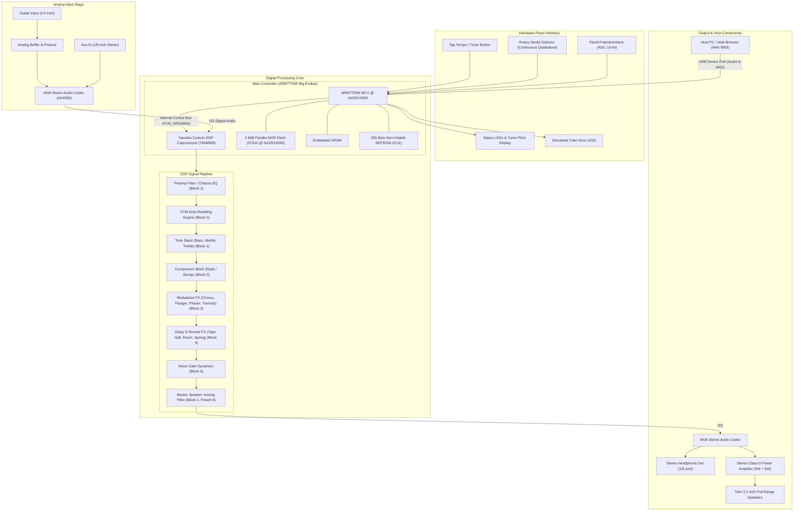

# Yamaha THR Hacker's Guide, Custom Tooling & Web Studio

An open-source reverse-engineering suite, practical modification cookbook, disaster recovery manual, and zero-install Web MIDI Studio focused on the **Yamaha THR5 and THR5A** desktop guitar amplifiers (with protocol and tooling compatibility across the broader THR series).

Whether you want to control your amp from a web browser, explore extended parameter manipulation over USB, customize your physical hardware controls, or study the firmware architecture, this repository provides everything you need.

> [!NOTE]
> **Hardware Scope:** All physical teardowns, chip analyses, and live hardware experiments were performed on a physical **Yamaha THR5A** (and verified with stock **THR5** firmware). We make no claims regarding the physical circuit identity of the THR10, THR10C, or THR10X models.
> 
> **Clean-Room Tooling:** This repository contains **clean-room tooling, documentation, and patch scripts only**. It does **NOT** distribute copyrighted Yamaha firmware binaries (`.bin`) or proprietary ROM dumps. You extract your own firmware directly from your physical hardware using the open-source tools provided here.

---

## Part 1: Practical "How-To" Guides

Designed for musicians and builders who want to get their tools running, back up their amp, and start customizing without getting bogged down in assembly theory:

### 1. Zero-Install Web MIDI Studio (Experimental Beta)

> [!NOTE]
> **Status: Unfinished Experimental Beta.**
> The Web Studio application is currently an **unfinished, experimental proof-of-concept**. It was developed primarily to demonstrate the reverse-engineered live SysEx protocols, settings-block model injection, and bidirectional Web MIDI control discovered during this project. While fully functional for testing live parameter adjustments and hidden models, it is **not** a polished commercial application. Feedback and community contributions are welcome!

Open the studio directly in your browser:
- **Local Application:** Open [`web-studio/index.html`](web-studio/index.html) in Google Chrome, Microsoft Edge, or Opera.
- **Hosted Application:** [https://coreymlawrence.github.io/thr-public/web-studio/](https://coreymlawrence.github.io/thr-public/web-studio/)
- Real-time two-way knob control, preset backups, and access to extended parameters (Wide Stereo, Tube Glow Lamp, Master Speaker Voicing).

### 2. [Tooling & Environment Setup Guide](guides/QUICKSTART_TOOLING.md)
A 3-minute guide to setting up Python, installing MIDI libraries (`mido`, `python-rtmidi`), and verifying USB connection with your amplifier.

### 3. [Extracting Your Factory Firmware Guide](guides/EXTRACTING_FIRMWARE.md)
How to boot into Update Mode (`U`), dump your amplifier's factory firmware over USB MIDI in 2.5 minutes, and verify your clean backup image.

### 4. [Standalone Hardware Customization & Patching Guide](guides/CREATING_CUSTOM_PATCHES.md)
How to customize your amplifier's physical hardware behavior directly on the chassis without a computer:
- **Understanding Standalone vs. USB Control:** Why firmware patching is used for standalone chassis customization, while parameters like compressors and cabinets are already accessible over USB via Yamaha's THR Editor.
- **Extensible Developer Boilerplate:** Using `tools/patch_template.py` as a clean Python starter template for creating and applying your own binary patches.
- **Demonstration Examples:** Modifying physical rotary selector bounds, configuring standalone boot defaults, and bypassing cabinet simulation for direct line-out use.

### 5. [Pre-Flight Verification & Flashing Guide](guides/VERIFY_AND_FLASH.md)
The mandatory safety checklist before flashing: SMF container validation, power rules (never flash on battery!), and what the hardware display shows during erase, write, and completion.

### 6. [The Complete Disaster Recovery & Unbricking Manual](guides/DISASTER_RECOVERY.md)
Your ultimate safety net:
- **Level 1 (Soft Recovery):** Restoring interrupted updates via hardware button combinations without opening the amp.
- **Level 2 (Hardware Recovery):** How to revive any frozen amplifier using a $5 CH341A SPI test clip on `IC11` by injecting byte `0x01` at offset `0x02` to force Update Mode (`U`).

---

## Part 2: The Deep-Dive Study ("In the Weeds")

For firmware developers, reverse engineers, and curious hackers who want to understand every register, opcode, and architectural secret of the Yamaha THR platform:

### System Architecture Overview



---

### The 12-Chapter Research Guide (`study/`)

1. **[Chapter 1: Hardware & Silicon Architecture](study/01_HARDWARE_AND_SILICON.md)** — Motherboard teardown, SoC (ARM7TDMI Big-Endian), AK4556 Codec, YMW808 DSP, NOR Flash, and empirical firmware cross-compatibility.
2. **[Chapter 2: Firmware Architecture & Memory Map](study/02_FIRMWARE_AND_MEMORY_MAP.md)** — Flash NOR layout, Section 0 bootloader vs Section 1 DTAb updater vs Section 2 DTAm, symbol catalog, and calling conventions.
3. **[Chapter 3: Live MIDI SysEx & The Dual-Door Security Bypass](study/03_LIVE_SYSEX_AND_DUAL_DOOR_PROTOCOL.md)** — Real-time MIDI SysEx (`0x10`), the Dual-Door security clamp discovery, settings block bypass (`0x20`), 276-byte patch format, and Yamaha checksum formula.
4. **[Chapter 4: DSP Coprocessor & Audio Pipeline](study/04_DSP_COPROCESSOR_AND_AUDIO_PIPELINE.md)** — Yamaha YMW808 architecture, algorithmic blocks 0 through 6, low-level command dispatcher `FUN_020184E6`, and audio routing.
5. **[Chapter 5: Tone Stack Analysis & Frequency Shaping](study/05_TONE_STACK_AND_FREQUENCY_RESPONSE.md)** — Interactive passive tone stacks, acoustic microphone simulation curves (Condenser, Dynamic, Tube, Nylon), and solving the 100 Hz clean bass spike.
6. **[Chapter 6: Effects Engine & 24-Bit Rack Compressor](study/06_EFFECTS_ENGINE_AND_RACK_COMPRESSOR.md)** — Studio Rack Compressor activation (`0x0201A292` NOP bypass), 37-row dynamics lookup table, modulation, acoustic delay, and reverb algorithms.
7. **[Chapter 7: Rotary Encoder & UI Subsystem Expansion](study/07_ROTARY_ENCODER_AND_UI_EXPANSION.md)** — Continuous grey-code rotary encoder operation, signed modulo-10 arithmetic, 7-segment `#` screen control, and tuner LED hardware isolation.
8. **[Chapter 8: EEPROM Memory Map & Hardware Unbricking](study/08_EEPROM_MAP_AND_HARDWARE_RECOVERY.md)** — Complete 256-byte EEPROM layout (`IC11`), persistent parameters, external SPI programmer wiring, and hardware recovery via byte `0x02 = 0x01`.
9. **[Chapter 9: Safety Protocol & Unicorn CPU Emulation](study/09_SAFETY_GATES_AND_CPU_EMULATION.md)** — The 4 Mandatory Pre-Flash Safety Gates, ARM Thumb Bit[0] rule, and Unicorn CPU emulation testing framework.
10. **[Chapter 10: Comparative Discovery Analysis](study/10_COMPARATIVE_DISCOVERY_ANALYSIS.md)** — Systematic technical analysis comparing this repository against Michael Forney's 2015 project (`michaelforney/thr10`).
11. **[Chapter 11: Python Tooling & Automation Guide](study/11_TOOLING_AND_AUTOMATION_GUIDE.md)** — Practical usage guide for `thr_tool.py`, `thr_live.py`, `thr_map.py`, and `patch_template.py`.
12. **[Chapter 12: Web MIDI Studio Architecture](study/12_WEB_MIDI_STUDIO_ARCHITECTURE.md)** — Design, W3C Web MIDI API implementation, custom canvas knobs, and zero-install browser control.

---

## Repository File Structure

```text
thr-public/
|-- .gitignore                     # Strict exclusion of proprietary binaries
|-- LICENSE                        # MIT License
|-- README.md                      # Master navigation hub & overview
|
|-- guides/                        # Part 1: Practical "How-To" Playbooks
|   |-- QUICKSTART_TOOLING.md      # Tooling & environment setup
|   |-- EXTRACTING_FIRMWARE.md     # Extracting & backing up factory firmware
|   |-- CREATING_CUSTOM_PATCHES.md # The custom patch recipe book
|   |-- VERIFY_AND_FLASH.md        # Pre-flight safety checks & flashing
|   `-- DISASTER_RECOVERY.md       # Complete hardware unbricking guide
|
|-- study/                         # Part 2: Deep-Dive Technical Chapters (01 to 12)
|   |-- 01_HARDWARE_AND_SILICON.md
|   |-- 02_FIRMWARE_AND_MEMORY_MAP.md
|   |-- 03_LIVE_SYSEX_AND_DUAL_DOOR_PROTOCOL.md
|   |-- 04_DSP_COPROCESSOR_AND_AUDIO_PIPELINE.md
|   |-- 05_TONE_STACK_AND_FREQUENCY_RESPONSE.md
|   |-- 06_EFFECTS_ENGINE_AND_RACK_COMPRESSOR.md
|   |-- 07_ROTARY_ENCODER_AND_UI_EXPANSION.md
|   |-- 08_EEPROM_MAP_AND_HARDWARE_RECOVERY.md
|   |-- 09_SAFETY_GATES_AND_CPU_EMULATION.md
|   |-- 10_COMPARATIVE_DISCOVERY_ANALYSIS.md
|   |-- 11_TOOLING_AND_AUTOMATION_GUIDE.md
|   `-- 12_WEB_MIDI_STUDIO_ARCHITECTURE.md
|
|-- tools/                         # Cross-Platform Python Tools & Templates
|   |-- thr_tool.py                # SMF packaging, unpacker, dump, and flash CLI
|   |-- thr_live.py                # Real-time bidirectional MIDI monitor & sender
|   |-- thr_map.py                 # Live settings block decoder
|   |-- thr_params.json            # Canonical parameter dictionary
|   `-- patch_template.py          # Reference Thumb assembler and patcher template
|
`-- web-studio/                    # Pure Web MIDI Browser Application
    |-- index.html                 # Responsive dark-theme studio interface
    |-- app.js                     # Two-way Web MIDI control engine
    |-- app.css                    # Hardware-accurate Yamaha chassis styling
    |-- thr-protocol.js            # SysEx encoder/decoder module
    `-- README.md                  # Web Studio usage and setup guide
```

---

## License

This project is licensed under the MIT License - see the [LICENSE](LICENSE) file for details.
