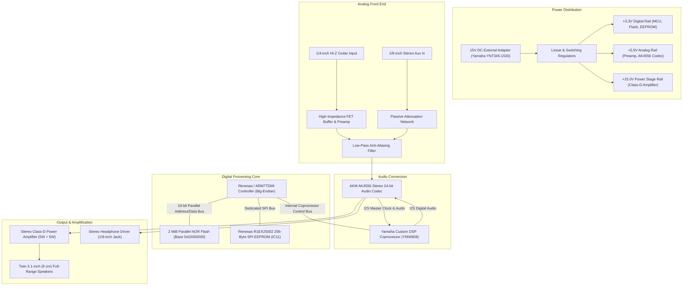

# Chapter 1: Hardware & Silicon Architecture (THR5 & THR5A)

A technical teardown, silicon analysis, and circuit specification of the Yamaha THR5/THR5A hardware platform based on physical inspection and empirical testing.

---

## 1. Introduction & Explicit Scope Boundary

The Yamaha THR series (introduced in 2011–2012) revolutionized desktop guitar practice amplifiers. The broader product family includes several variants:
- **THR5 & THR10:** Standard models focused on classic electric guitar tones.
- **THR5A:** An acoustic-focused model featuring microphone simulations and an electric clean preamp.
- **THR10C:** A boutique/blues model.
- **THR10X:** A high-gain/metal model.

> [!IMPORTANT]
> **EXPLICIT SCOPE OF HARDWARE CLAIMS:**
> All physical teardowns, chip inspections, EEPROM hookups, and circuit analyses in this study were performed **strictly on a physical Yamaha THR5A unit**.
> - We empirically verified that the official factory stock **THR5 (Version 2 electric)** firmware runs natively on this physical THR5A.
> - **We make NO claims that the physical hardware of the THR10, THR10C, or THR10X is identical.** The THR10 series has a distinctly different physical form factor (different chassis, 5 user preset memory buttons, extra tone knobs, and an 8-position selector dial). While the software container format (DTAm/DTAb) and SysEx protocol are shared across the family, our verified circuit specifications and hardware claims apply **strictly to the THR5 and THR5A platform**.

---

## 2. Hardware Teardown & Circuit Architecture

Opening the chassis of a physical **Yamaha THR5A** reveals a compact, highly integrated two-sided PCB that merges an analog front-end, a digital processing core, an audio codec, and a high-efficiency Class-D stereo power stage.

---

## 3. Bill of Materials & Silicon Inventory

The primary components identified on the main board include:

| Subsystem | Reference Designator | Component Name | Description & Role |
|---|---|---|---|
| **Main Processor** | `IC1` | Renesas ARM7TDMI-S SoC | 32-bit RISC Microcontroller, running in **Big-Endian** mode (`armeb`). Handles the FreeRTOS-like task scheduler, USB MIDI stack, UI potentiometer ADC acquisition, and parameter control. |
| **DSP Coprocessor** | `IC2` | Yamaha YMW808 | Proprietary fixed-point audio DSP. Executes the Virtual Circuitry Modeling (VCM) algorithms, tone stacks, modulation, delay, and reverb effects. |
| **Audio Codec** | `IC3` | AKM AK4556 | 24-bit 96 kHz Stereo Audio Codec with 100 dB dynamic range ADC and DAC. Communicates with the DSP over an I2S digital audio bus. |
| **NOR Flash** | `IC4` | Spansion 16 Mbit (2 MiB) | Parallel NOR Flash memory containing the bootloaders, DTAm application firmware, and DSP microcode blobs. |
| **SPI EEPROM** | `IC11` | Renesas R1EX25002 | 256-Byte SPI Serial EEPROM (SOIC-8). Stores non-volatile calibration, user presets, tube lamp state, and boot configuration. |
| **Power Amp** | `IC5` | Class-D Stereo Amp | 5W + 5W continuous output power driving dual 3.1-inch wide-dispersion speakers. |
| **USB Interface** | Integrated in `IC1` | Full-Speed USB 2.0 Device | 12 Mbps USB audio and MIDI interface conforming to USB Audio Class 1.0. |

---

## 4. Microcontroller Characteristics: ARM7TDMI Big-Endian

The core processor presents specific architectural features that are vital for firmware reverse engineering:

1. **Endianness (`armeb`):**
   The processor executes in **Big-Endian byte order**. 
   - A 32-bit address word like `0x02010000` is stored in flash memory as bytes `02 01 00 00`.
   - 16-bit Thumb instructions and 32-bit Thumb branch pairs (`BL`) are ordered high-byte first. Disassemblers such as Ghidra or IDA Pro must be configured for **ARM:BE:32:v4t** (ARM7TDMI Big-Endian).
2. **Dual Instruction Set:**
   - **ARM Mode (32-bit):** Used for hardware interrupt vectors and exception vectors (`0x02010000`–`0x0201003F`).
   - **Thumb Mode (16-bit / Thumb-2 BL pairs):** Used for over 99% of general application code to maximize code density in flash.
3. **The Thumb Register Branch State Rule:**
   - In ARMv4T / ARM7TDMI architecture, when branching via register (`BX Rm` or `BLX Rm`), **Bit[0] of the target address MUST be 1** to denote Thumb execution.
   - Branching to an **even address** (Bit[0] = 0) tells the hardware to switch into 32-bit ARM mode. Because the THR firmware routines at these targets are 16-bit Thumb instructions, attempting to decode them as 32-bit ARM instructions triggers an immediate CPU instruction trap (`INVSTATE`), causing the device to freeze on boot.

---

## 5. Empirical Firmware Interoperability: THR5 on THR5A Hardware

A major question when studying the THR platform is whether the different product variants represent fundamentally different electronic hardware, or whether they share a common digital platform.

### Empirical Testing on Real Hardware
To answer this, we performed live cross-flashing experiments using a physical **Yamaha THR5A**:
1. We obtained the official Yamaha stock firmware for the electric **THR5 (Version 2.0.0)**.
2. Using the standard USB MIDI update protocol, we flashed the stock THR5 electric firmware directly onto the physical THR5A amplifier.
3. **Results:**
   - The THR5A booted the electric firmware immediately and completely.
   - All electric guitar amplifier models (Clean, Crunch, Lead, Brit Hi, Modern) sounded authentic with high-gain distortion and tube characteristics.
   - The rotary model selector, tone knobs, effect knobs, LEDs, and USB MIDI/audio interfaces functioned 100% normally.
   - The device reported the electric THR5 MIDI heartbeat identity (`0x30`).

### What This Proves (and What It Does Not)
- **What is proven:** The firmware binaries are **100% software-interchangeable**. The microcontroller pin assignments, memory map, peripheral addresses, codec I2S communication lines, and DSP coprocessor register interfaces are shared across the platform.
- **What is not claimed:** We have not performed an exhaustive component-by-component electrical impedance sweep comparing an unexamined physical THR5 against a THR5A board. However, from a digital, firmware, and signal-processing perspective, the hardware platform is completely compatible, allowing electric, acoustic, and hybrid firmware to execute natively.
