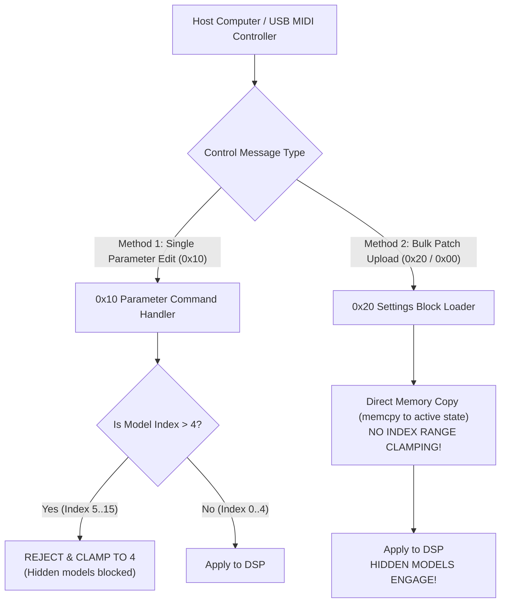

# Chapter 3: Live MIDI SysEx & The Dual-Door Security Bypass

A complete specification of real-time parameter control over USB MIDI, the discovery of the Dual-Door security clamp architecture, and the structure of the 276-byte amplifier settings block.

---

## 1. Yamaha System Exclusive (SysEx) Framing

The Yamaha THR communicates bidirectionally over standard USB MIDI endpoint 1 using System Exclusive messages wrapped in the Yamaha manufacturer header:

```
[0xF0] [0x43] [0x7D] [<SubID>] [<Payload...>] [0xF7]
  |      |      |        |
  |      |      |        +--> Protocol Category (0x10, 0x20, 0x30, 0x50)
  |      |      +------------> Product Family ID (THR Desktop Amplifiers)
  |      +-------------------> Yamaha Manufacturer ID
  +--------------------------> Start of Exclusive (SOX)
```

---

## 2. The Dual-Door Security Architecture

One of the most consequential discoveries made in this study is the **Dual-Door Model Clamping Architecture** built into the Yamaha firmware.

On the 5-position amplifiers (THR5 and THR5A), the factory firmware restricts model selection from the physical rotary dial to the 5 models printed on the chassis. Yamaha also implemented input clamping over MIDI to prevent users from selecting other models over the wire. However, they only clamped one of the two input paths:



### The Bypass in Practice
1. **The Parameter Command Door (`0x10`):**
   Sending `F0 43 7D 10 41 30 01 00 <model_id> F7` triggers a validation routine:
   ```arm
   cmp     r1, #4
   bhi     reject_parameter
   ```
   Any attempt to send index `5` (Bass), `6` (Aco), or `7` (Flat) is silently dropped.
2. **The Settings Block Door (`0x20` / `0x00`):**
   Sending the 276-byte bulk state packet executes the settings parser. The parser copies `data[128]` (amp model byte) and `data[134]` (cabinet byte) directly into the live DSP state without evaluating the range clamp.
3. **The Result:**
   Any model resident in the loaded firmware's DSP image can be activated on physical stock hardware over USB MIDI simply by injecting the model byte into the bulk settings block and transmitting it.

---

## 3. The 276-Byte Settings Block Structure

A complete settings state packet has an exact length of **276 bytes**:

```
+---------------------------------------------------------------------------------+
| Offset (Bytes) | Length   | Field Name            | Description                 |
|----------------+----------+-----------------------+-----------------------------|
| 0 to 17        | 18 Bytes | SysEx Header          | F0 43 7D 20 44 54 41 31 ... |
| 18 to 273      | 256 Bytes| Amplifier State Block | Active parameter payload    |
| 274            | 1 Byte   | Yamaha Checksum       | 7-bit two's complement sum  |
| 275            | 1 Byte   | EOX                   | 0xF7                        |
+---------------------------------------------------------------------------------+
```

### Critical Offsets Inside the 256-Byte Payload (`data[0..255]`)

| Payload Index | Offset from 0xF0 | Function / Parameter | Value Range |
|---|---|---|---|
| `data[128]` | Byte 146 | **Active Amp Model** | `0`=Clean, `1`=Crunch, `2`=Lead, `3`=Brit Hi, `4`=Modern, `5`=Bass, `6`=Aco, `7`=Flat |
| `data[129]` | Byte 147 | Gain | `0`–`100` |
| `data[130]` | Byte 148 | Master Volume | `0`–`100` |
| `data[131]` | Byte 149 | Bass | `0`–`100` |
| `data[132]` | Byte 150 | Middle | `0`–`100` |
| `data[133]` | Byte 151 | Treble | `0`–`100` |
| `data[134]` | Byte 152 | **Cabinet Emulation Type** | `0`=American 4x12, `1`=British 4x12, `2`=Brown 4x12, `3`=1x12, `4`=2x12, `5`=4x10, `6`=Flat |
| `data[140]` | Byte 158 | Compressor Type | `0`=Stomp, `1`=Rack |
| `data[141]` | Byte 159 | Compressor Sustain / Threshold | `0`–`100` |
| `data[142]` | Byte 160 | Compressor Output Level | `0`–`100` |
| `data[150]` | Byte 168 | Modulation Effect Type | `0`=Chorus, `1`=Flanger, `2`=Phaser, `3`=Tremolo |
| `data[151]` | Byte 169 | Modulation Speed | `0`–`100` |
| `data[160]` | Byte 178 | Delay / Reverb Type | `0`=Tape Echo, `1`=Delay, `2`=Hall, `3`=Room, `4`=Plate, `5`=Spring |
| `data[170]` | Byte 188 | Noise Gate Threshold | `0`–`100` |

---

## 4. The Yamaha 7-Bit Two's Complement Checksum

The checksum at byte offset 274 ensures transmission integrity. Yamaha uses an inverted 7-bit accumulator formula covering the 256 data bytes:

$$\left(\sum_{i=0}^{255} \text{data}[i] + \text{checksum}\right) \pmod{128} = 0$$

### Python Implementation
```python
def calculate_yamaha_checksum(data_bytes: bytes) -> int:
    """
    Computes the Yamaha 7-bit checksum for THR settings blocks.
    Covers the 256 data payload bytes (indices 18 to 273).
    """
    total = sum(data_bytes) & 0x7F
    checksum = (0x80 - total) & 0x7F
    return checksum

def verify_settings_block(packet: bytes) -> bool:
    if len(packet) != 276:
        return False
    data_payload = packet[18:274]
    expected_csum = calculate_yamaha_checksum(data_payload)
    return packet[274] == expected_csum
```

---

## 5. Non-Volatile System Preferences (`SubID 0x30`)

Commands using SubID `0x30` bypass volatile RAM and write directly to the onboard SPI EEPROM (`IC11`):

1. **Wide Stereo Toggle:**
   `F0 43 7D 30 41 30 00 <val> F7` (`0x00` = Off, `0x01` = On)
2. **Tube Glow Simulated Lamp Toggle:**
   `F0 43 7D 30 41 30 01 <val> F7` (`0x00` = Off, `0x01` = On)
3. **Master Speaker Voicing Curve (Setting `0x02`):**
   `F0 43 7D 30 41 30 02 <val> F7` (`0x28` to `0x40`)
   - Controls the high-frequency de-emphasis and resonance damping filter on the twin 3.1" speakers.
   - Adjusting this removes harsh high-end sizzle from acoustic guitars or boosts clarity for clean electric tones.
