# Chapter 4: DSP Coprocessor & Audio Pipeline

An exhaustive examination of the Yamaha YMW808 digital signal processor, internal algorithmic block mapping, low-level parameter dispatching, and digital audio routing.

---

## 1. Yamaha YMW808 Coprocessor Architecture

The Yamaha YMW808 is a custom fixed-point audio DSP coprocessor optimized for Yamaha's proprietary **Virtual Circuitry Modeling (VCM)** algorithms.

```mermaid
graph LR
    subgraph HostMCU ["Main MCU Control"]
        Dispatch["FUN_020184E6<br/>(coproc, block, param, val)"]
    end

    subgraph AudioIn ["Audio Conversion"]
        ADC["AK4556 24-bit ADC"] -->|"I2S Master Clock (44.1 kHz)"| Block1Pre["Block 1: Preamp EQ"]
    end

    subgraph YMW808 ["Yamaha YMW808 Audio Pipeline"]
        Block1Pre --> Block0["Block 0: VCM Amp Model"]
        Block0 --> Block1Tone["Block 1: Tone Stack (B/M/T)"]
        Block1Tone --> Block5["Block 5: Dynamics / Compressor"]
        Block5 --> Block3["Block 3: Modulation Engine"]
        Block3 --> Block4["Block 4: Delay & Reverb Engine"]
        Block4 --> Block6["Block 6: Studio Noise Gate"]
        Block6 --> Block2["Block 2: Cabinet IR Filter"]
        Block2 --> Block1Master["Block 1: Master Voicing (Param 8)"]
    end

    subgraph AudioOut ["Audio Output"]
        Block1Master -->|"I2S Audio Out"| DAC["AK4556 24-bit DAC"]
        DAC --> PowerAmp["Class-D Stereo Amplifier"]
        DAC --> HeadphoneOut["Stereo Headphone Jack"]
    end

    Dispatch -.->|"Register Write"| Block0
    Dispatch -.->|"Register Write"| Block1Tone
    Dispatch -.->|"Register Write"| Block2
    Dispatch -.->|"Register Write"| Block3
    Dispatch -.->|"Register Write"| Block4
    Dispatch -.->|"Register Write"| Block5
    Dispatch -.->|"Register Write"| Block6
    Dispatch -.->|"Register Write"| Block1Master
```



---

## 2. DSP Algorithmic Block Directory

The DSP firmware divides processing tasks into 7 discrete logical blocks:

### Block 0: Virtual Circuitry Modeling (VCM) Core
- **Function:** Solves differential circuit equations modeling vacuum tube stages, transformer saturation, and non-linear power amp sag.
- **Parameters:**
  - `Param 0`: Preamp saturation drive.
  - `Param 1`: Power amplifier bias & non-linear compression.
  - `Param 2`: Sag recovery time constant.

### Block 1: Filter Core & Tone Stack
- **Function:** Handles analog tone stack simulation (Bass, Middle, Treble) and master resonance filtering.
- **Parameters:**
  - `Param 0`–`Param 2`: Passive tone stack component values (interactive Duncan/Marshall/Fender tone stacks).
  - `Param 8`: **Master Speaker Voicing Resonance Filter**. Directly alters the final speaker baffle compensation curve (controlled via SysEx `0x30` / Setting `0x02`).

### Block 2: Speaker Cabinet Emulation
- **Function:** Implements finite impulse response (FIR) convolution filtering simulating physical speaker enclosures and acoustic room reflections.
- **Cabinet Models:**
  - `0`: American 4x12 (Fender Bassman style)
  - `1`: British 4x12 (Marshall 1960A Greenback)
  - `2`: Brown 4x12 (Celestion Vintage 30)
  - `3`: 1x12 (Open-back Fender Deluxe Reverb)
  - `4`: 2x12 (Vox AC30 Alnico Blue)
  - `5`: 4x10 (Tweed Super)
  - `6`: Flat (Full-range bypass curve)

### Block 3: Modulation Effects
- **Function:** Dual-delay line chorus, bucket brigade device (BBD) flanger, multi-stage optical phaser, and bias-tremolo.
- **Parameters:**
  - `Param 0`: LFO rate (0.1 Hz to 20 Hz).
  - `Param 1`: Modulation depth.
  - `Param 2`: Regeneration / Feedback resonance.

### Block 4: Time-Based Effects (Delay & Reverb)
- **Function:** Tape echo simulation with wow/flutter, clean digital delay, and physical acoustic room simulation (Hall, Room, Plate, Spring).
- **Parameters:**
  - `Param 0`: Delay time (1 ms to 2,000 ms).
  - `Param 1`: Feedback level.
  - `Param 2`: Reverb decay time.
  - `Param 3`: Wet / Dry mix ratio.

### Block 5: Dynamics Processor (Compressor)
- **Function:** Dual-personality compression engine:
  - **Type 0 (Stompbox):** Aggressive optical compressor with fast attack and non-linear release.
  - **Type 1 (Studio Rack):** Transparent 24-bit studio compressor with 37-row lookahead dynamics table.

### Block 6: Studio Noise Gate
- **Function:** Dynamic expansion gate with program-dependent attack and decay to silence high-gain hiss without clipping guitar sustain tails.

---

## 3. Low-Level Dispatcher: `FUN_020184E6`

All high-level UI controls and SysEx messages eventually converge on the assembly routine `FUN_020184E6`.

### C Function Signature
```c
int FUN_020184E6(int coproc_id, int block_id, int param_id, int value);
```

### Calling Convention & Register Allocation
- **`R0` (`coproc_id`):** Microcode coprocessor instance (always `0x00` on THR).
- **`R1` (`block_id`):** Target DSP block (`0` through `6`).
- **`R2` (`param_id`):** Specific parameter offset within the target block.
- **`R3` (`value`):** 16-bit parameter data word.

### Execution Mechanism
1. Computes the base register address: `addr = DSP_BASE + (block_id * BLOCK_STRIDE) + param_id`.
2. Validates that the coprocessor ready flag is asserted.
3. Issues a memory-mapped 16-bit register write over the internal controller bus.
4. Returns status code `0x00` on success.
