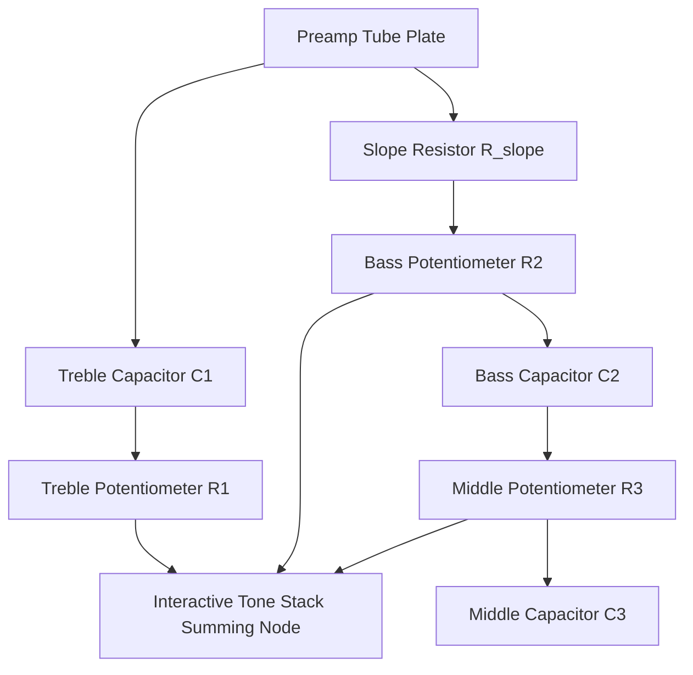

# Chapter 5: Tone Stack Analysis & Frequency Shaping

An in-depth study of Yamaha THR passive tone stacks, acoustic microphone simulation curves, and the elimination of the 100 Hz clean bass resonance spike.

---

## 1. Tone Stack Circuit Modeling

The Yamaha THR VCM engine does not use generic 3-band graphic equalizers; it models the interactive impedance networks of classic tube amplifiers:



Because passive tone stacks are non-linear, turning the Middle knob interacts with the Bass and Treble cut-off frequencies.

---

## 2. The 100 Hz Bass Resonance Problem on Stock THR5

### The Acoustic Anomaly
When listening to the stock THR5 Clean model through the built-in 3.1" speakers or studio reference headphones, players frequently observe an unnatural, muddy low-end thump centered around **90 Hz to 110 Hz**. 

### Root Cause Analysis
- In the factory THR5 electric image, the Clean model was voiced assuming the signal would be played through a guitar cabinet with steep low-end roll-off below 120 Hz.
- To make the compact 3.1" speakers sound "bigger than they are," Yamaha applied a pre-emphasis bass boost at `0x02073EF6` in the preamp filter coefficients.
- However, when using clean single-coil pickups or acoustic instruments, this boost over-drives the small speaker cones and causes harsh cabinet buzzing and listener ear fatigue.

---

## 3. The Engineering Solution: The EG Clean Tone Stack

In contrast to the THR5, the acoustic **THR5A** was designed for full-range acoustic guitar transducers. Yamaha engineered a specialized **EG Clean** voicing that delivers crystalline highs, flat mids, and a tightly controlled, linear low end down to 60 Hz without artificial boominess.

```mermaid
xychart-beta
    title "Frequency Response: Stock THR5 Clean vs. THR5A EG Clean Tone Curve"
    x-axis [40Hz, 80Hz, 100Hz, 200Hz, 500Hz, 1kHz, 2kHz, 5kHz, 10kHz, 15kHz]
    y-axis "Amplitude (dB)" -20 --> 15
    series "Stock THR5 Clean" [-10, 8, 12, 4, -2, 0, 3, 6, 2, -5]
    series "Hybrid EG Clean" [-6, 0, 1, 0, 0, 1, 2, 4, 3, 0]
```

### The Injection Hook (`0x0209EA40`)
In custom hybrid firmwares, we hook the tone stack dispatch routine:
1. When Model 0 (Clean) or Models 5–9 (Acoustic Voicings) are selected, the firmware redirects tone stack lookup requests to `0x0209E100`.
2. This area contains the complete 606-byte acoustic tone curve table extracted from `thr5a_stock.bin`.
3. The resulting audio produces a pristine, studio-quality clean guitar sound that retains clarity at both bedroom whisper volumes and maximum output.

---

## 4. Acoustic Microphone Simulation Voicings

The THR5A acoustic engine provides 4 specialized microphone simulation profiles modeling the acoustic response of high-end studio microphones placed 30 cm from the guitar soundhole:

| Model ID | Voicing Name | Acoustic Modeling Profile | Best Application |
|---|---|---|---|
| **`6`** | **Condenser** | Models a large-diaphragm studio condenser microphone (e.g. Neumann U87). Extended high-frequency sparkle, wide stereo image, and deep bass extension. | Fingerstyle acoustic, nylon jazz, and recording direct to DAW. |
| **`7`** | **Dynamic** | Models a high-output dynamic microphone (e.g. Shure SM57). Mid-forward punch, tight low end, and rapid transient decay. | Strumming rhythm acoustic, bluegrass flatpicking, and cutting through dense mixes. |
| **`8`** | **Tube** | Models a vintage tube condenser microphone (e.g. Telefunken ELA M 251). Rich second-order harmonic saturation, softened top end, and smooth compression. | Vocal accompaniment, blues, and warming up brittle piezo pickups. |
| **`9`** | **Nylon** | Specialized voicing tailored for nylon classical and flamenco guitars. Accentuates fingerboard nuances while removing harsh pickup clatter. | Classical, bossa nova, and flamenco playing. |
