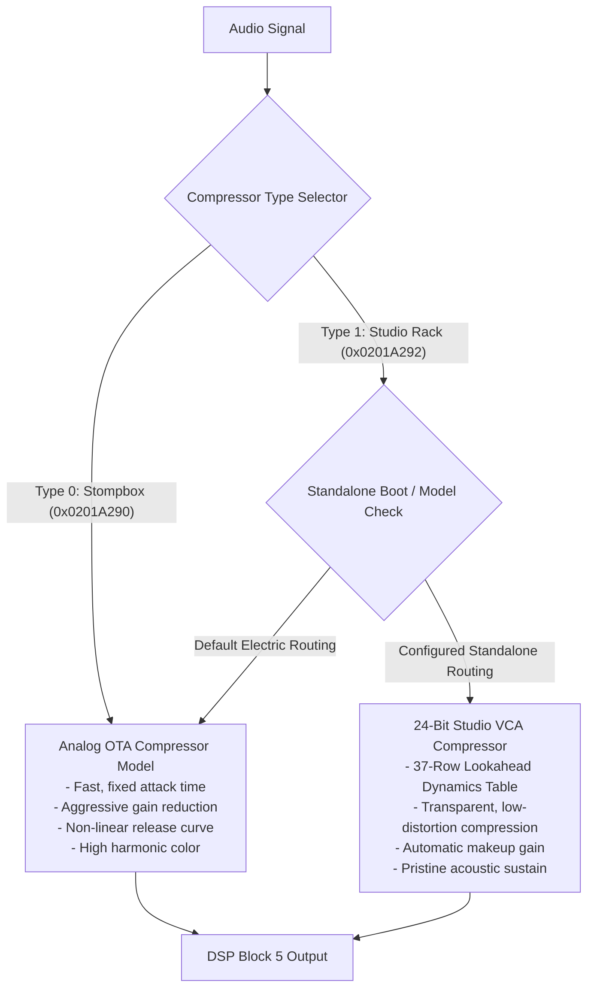

# Chapter 6: Effects Engine & 24-Bit Rack Compressor

An architectural guide to the modulation, delay, reverb, noise gate, and dynamics processing algorithms inside the Yamaha THR DSP engine.

---

## 1. Dynamics Architecture: Stompbox vs. Studio Rack Compressor

The Yamaha THR firmware includes two distinct compressor engines resident within DSP Block 5:

### Standalone Operation vs. USB MIDI Access
It is important to understand the relationship between software control and standalone hardware execution:
- **USB MIDI Access (Official THR Editor):** When connected to a computer, Yamaha's official THR Editor allows users to select and configure compressor parameters over USB MIDI. The DSP engine natively supports dynamics processing across models.
- **Standalone Hardware Execution:** On compact models like the THR5, there is no dedicated "Compressor" knob or button on the physical faceplate. When playing standalone without a computer, the amplifier relies strictly on internal firmware initialization rules and preset definitions.
- **Standalone Customization:** By customizing the dynamics routing logic at `0x0201A292` (e.g. bypassing restrictive model condition checks with a 16-bit `NOP` `0x46C0`), the amplifier can be configured to initialize with studio rack dynamics active during standalone operation—bringing studio compression to portable playing without needing a computer attached.
- **Dynamics Table Structure:** The studio compressor utilizes a 37-row lookahead dynamics lookup table (444 bytes) that feeds DSP Block 5 output ID `0x97`, providing transparent, low-distortion compression.

---

## 2. Modulation Algorithms (DSP Block 3)

The modulation engine models vintage analog analog circuitry:

| Effect ID | Effect Name | Circuit Emulation Details | Primary Controls |
|---|---|---|---|
| **`0`** | **Chorus** | Models the classic CE-1 analog bucket-brigade device (BBD) stereo chorus. Uses dual anti-phase delay lines for ultra-wide stereo width. | Speed (`0`–`100`), Depth (`0`–`100`). |
| **`1`** | **Flanger** | Emulates a 1024-stage BBD flanger with variable positive/negative regeneration feedback. Capable of jet-plane swooshes and metallic comb filtering. | Speed, Depth, Manual, Feedback. |
| **`2`** | **Phaser** | Models a 4-stage optical phase shifter (MXR Phase 90 style). Produces liquid, swirling harmonic sweeps without amplitude modulation. | Speed, Depth. |
| **`3`** | **Tremolo** | Emulates vintage tube amp optical bias-tremolo. Modulates audio amplitude with a smooth sinusoidal LFO. | Speed, Depth. |

---

## 3. Time-Based Effects: Delay & Reverb (DSP Block 4)

Yamaha combined delay and reverb into a unified high-resolution DSP block:

### Delay Models
- **Tape Echo:** Emulates a 3-head tape machine (Maestro Echoplex style) with modeled tape saturation, motor wow/flutter, and high-frequency decay on repeats.
- **Digital Delay:** Transparent 24-bit digital delay with crystal-clear repeats and tempo synchronization up to 2,000 ms.

### Reverb Models
- **Hall:** Simulates the lush, diffuse reverberation of a 2,500-seat European concert hall.
- **Room:** Models a warm, wood-paneled recording studio room with defined early reflections.
- **Plate:** Emulates an EMT 140 vintage steel plate reverb with instant diffusion and shimmering high-frequency response.
- **Spring:** Virtual physical model of a dual-spring reverb tank found in American blackface tube combos, complete with characteristic spring "drip" on hard pick transients.

---

## 4. Studio Noise Gate Dynamics (DSP Block 6)

The Yamaha THR noise gate is located after the preamp and modulation stages but before time-based delay/reverb, preventing delay trails from being abruptly chopped off:

- **Dynamic Attack & Release:** Adjusts envelope release times based on the velocity of pick attack. Fast transients open the gate in sub-millisecond times, while sustaining notes fade out smoothly.
- **Threshold Control:** Adjustable via SysEx parameter `0x40` (0 to 100).
