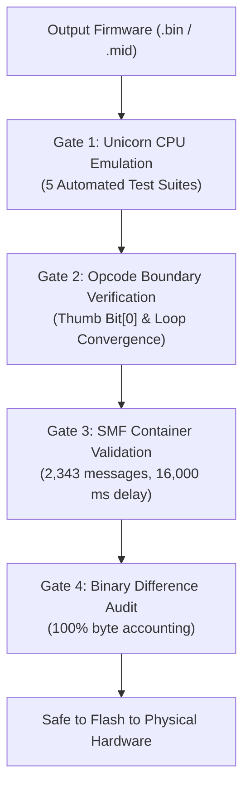

# Chapter 9: Safety Protocol & Unicorn CPU Emulation

The mandatory verification framework required to mathematically prove instruction validity and prevent physical hardware lockups.

---

## 1. Why Firmware Safety Matters on Hardware

The Yamaha THR desktop amplifier hardware does not feature a dual-bank boot failover system. A single invalid instruction, misaligned branch, or Thumb state violation in boot-critical code paths will permanently freeze the microcontroller during initialization.

To eliminate bricking risks, every proposed firmware binary must pass the **4 Mandatory Pre-Flash Safety Gates**:



---

## 2. Gate 1: Unicorn CPU Emulation Suite

Before any binary touches physical hardware, it is executed inside a software-emulated ARM7TDMI processor using the **Unicorn Engine** in Python.

### The 5 Automated Test Suites

```python
# emu_test_framework.py
from unicorn import *
from unicorn.arm_const import *

# Initialize ARM Big-Endian CPU emulator
mu = Uc(UC_ARCH_ARM, UC_MODE_ARM | UC_MODE_BIG_ENDIAN)
```

1. **Boot Vector Suite:**
   - Emulates reset vector execution from `0x02010000` through hardware initialization (`0x0202AF68`–`0x0202AFF6`).
   - Verifies stack pointer configuration and vector table integrity.
2. **Task 4 Continuous Dial Suite:**
   - Emulates the continuous grey-code rotary encoder rotating through positions `0` $\rightarrow$ `9` $\rightarrow$ `0` and reverse `0` $\rightarrow$ `9`.
   - Validates signed modulo-10 arithmetic, upper/lower bounds, and zero-divide traps.
3. **Task 4 Knob Sweep Suite:**
   - Simulates ADC input sweeps across all 11 potentiometers (Gain, Master, Bass, Middle, Treble, Effect, Dly/Rev, Guitar, USB, Aux, Preset).
   - Validates that ADC shadow buffers invalidate and reload without arithmetic exceptions.
4. **Tuner Enter & Exit Suite:**
   - Simulates pressing TAP/TUNER, running pitch detection routines, and exiting back to amplifier mode.
   - Verifies that model LEDs and screen `#` symbols restore to exact previous state.
5. **Preset Recall Suite:**
   - Simulates switching through user preset banks 1 through 5.
   - Validates memory bounds and boundary clamps.

**Gate Criteria:** All 5 suites must complete with **zero CPU exceptions**, zero unmapped memory reads, and zero invalid instruction traps.

---

## 3. Gate 2: Opcode Boundary Verification & The Thumb Bit[0] Rule

### Case Study: Why Register Branching Can Lock the CPU (The Thumb Bit[0] Rule)
On ARM7TDMI processors, executing an indirect register branch (`BX Rm` or `BLX Rm`):
- **Bit[0] of register `Rm` dictates the target CPU state:**
  - `Bit[0] == 1`: Target executes in **Thumb Mode** (16-bit).
  - `Bit[0] == 0`: Target executes in **ARM Mode** (32-bit).

During experimental testing of an audio routing patch, an indirect register branch was written:
```python
# FLAWED INDIRECT BRANCH:
addr_target = 0x02019E42  # Even address (Bit 0 = 0)
asm.emit16(0x4718)        # bx r3 -> switches CPU to ARM 32-bit mode!
```
Because the destination code at `0x02019E42` was compiled in Thumb mode, forcing the CPU into ARM mode caused an immediate `INVSTATE` CPU instruction trap on boot, freezing the device instantly!

**The Golden Rule:** Always ensure register branch targets have Bit[0] set (`addr | 1`), or use `mov pc, reg` which does not alter instruction states on ARM7TDMI.

### Task 4 Loop Convergence Opcode
All branches and loops in the Task 4 dial polling routine must converge on address `0x0202C490` containing opcode `0x4D86`:
```arm
Address: 0x0202C490
Opcode:  0x4D86  ; ldr r5, [pc, #0x218]
```

---

## 4. Gate 3: SMF Container Validation

The generated `.mid` firmware container must strictly comply with Yamaha's Standard MIDI File Type 0 specification:

1. **Message Count:** Exactly **2,343 MIDI SysEx events**.
2. **Payload Blocks:** Exactly **2,341 data blocks** carrying 512 bytes each.
3. **Erase Delay Timing:** The flash erase command must be followed by an exact **16,000 ms (16.0 second)** delta-time delay.
4. **Global DTAm Checksum:** The final packet must be a `DTA1CSUM` command whose checksum matches the cumulative DTAm image.

---

## 5. Gate 4: Binary Difference Audit

Every modified byte in the output binary must be accounted for against factory stock:
- **Section 0 (`0x02000000`–`0x020000FF`):** Must be **100% untouched stock**.
- **Section 1 (`0x02000100`–`0x0200FFFF`):** Must be **100% untouched stock**.
- **Section 2 (`0x02010000`–`0x0210FFFF`):** Every modified address must map to a documented, verified patch stub.
