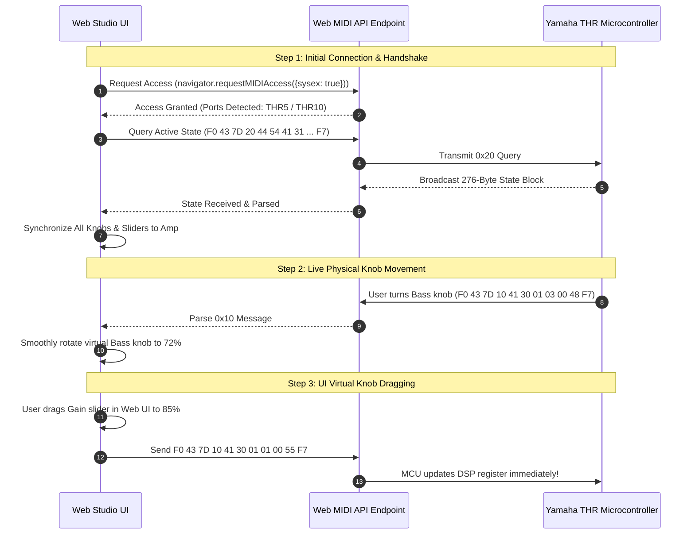

# Chapter 12: Web MIDI Studio Architecture

An engineering analysis of the zero-installation, browser-based Web MIDI Studio application located in `web-studio/`.

> [!NOTE]
> **Status: Experimental Beta / Proof-of-Concept**
> The Web Studio application is currently an **unfinished, experimental prototype**. It was developed primarily to demonstrate and validate the reverse-engineered live SysEx protocols, settings-block injection, and bidirectional Web MIDI control in real time, rather than as a finished or polished end-user product. It demonstrates what is technically possible over Web MIDI directly from a browser.

---

## 1. Zero-Install Design Philosophy

Historically, configuring guitar modeling amplifiers required installing manufacturer desktop drivers, proprietary software, or virtual machines.

The **THR Web Studio** eliminates all external software dependencies by leveraging the **W3C Web MIDI API**:
- **Zero Drivers / Zero Installation:** Runs directly inside any modern Chromium browser (Google Chrome, Microsoft Edge, Brave, Opera).
- **Cross-Platform:** Works identically on Windows, macOS, Linux, and Android devices supporting USB OTG.
- **Pure Client-Side:** Static HTML5, CSS3, and JavaScript (`ES6+`) with zero backend server requirements.

---

## 2. Bidirectional Communication Engine (`thr-protocol.js` & `app.js`)

---

## 3. UI Styling & Custom Canvas Controls

The visual design in `web-studio/app.css` replicates the industrial aesthetic of the physical amplifier:
- **Chassis Texture:** High-contrast dark textured metal finish matching Yamaha's powder-coated steel housing.
- **Amber Glow Simulation:** CSS box-shadows and radial gradients emulating the warm amber glow of 12AX7 vacuum tubes peering through the speaker grille.
- **Custom Rotational Knobs:** Dynamic HTML5 Canvas rendering producing responsive, touch-friendly rotary potentiometers with realistic pointer notches and value readouts.

---

## 4. Local Preset Storage & Import/Export

The application allows users to store an unlimited number of custom tones locally:
- **Browser Persistence:** Stores complete 276-byte patch dumps in browser `localStorage`.
- **JSON Import / Export:** Back up entire preset libraries to disk or share patch files with other musicians across the globe.
- **Extended System Parameters:** Dedicated toggles for persistent non-volatile settings (Wide Stereo, Simulated Tube Lamps, and Speaker Voicing EQ curves).
